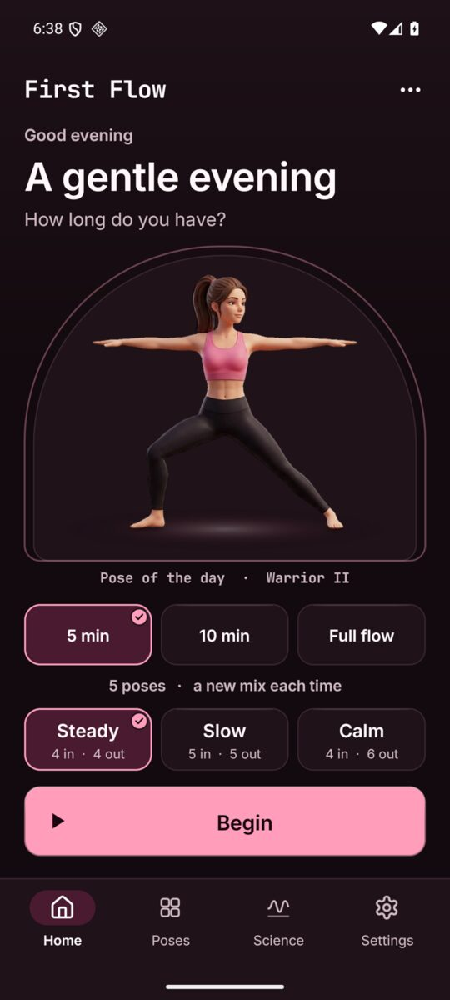

  

<h1 align="center">First Flow</h1>

20 gentle beginner yoga poses, guided one breath at a time with singing bowls. Pay once, no ads, works fully offline.

  <a href="https://play.google.com/store/apps/details?id=com.zanoshky.firstflow&amp;referrer=utm_source%3Dgithub%26utm_medium%3Dguide%26utm_campaign%3Dfirst-flow-2026-11"><b>Google Play</b></a> ·
  <a href="https://firstflow.zanoski.com"><b>firstflow.zanoski.com</b></a> ·
  <a href="https://zanoshky.github.io/first-flow-app/"><b>User guide</b></a> ·
  <a href="https://github.com/Zanoshky/first-flow-app/issues/new/choose"><b>Report a bug</b></a>

  

This repo is the public home for First Flow users: the user guide, bug reports and feature requests. The app itself is a paid Android app and its source is not here.

## Quick start

1. Install First Flow from Google Play. It runs on Android 10 or newer, and on Android TV and Google TV.
2. On Home, pick 5 min, 10 min or the Full flow of 20 poses, and a pace: Steady, Slow or Calm.
3. Press Begin. Each pose has a short get ready time, then a few slow breaths.
4. Breathe with the ring: it fills as you breathe in and empties as you breathe out.
5. Pause, go back or skip ahead any time. Stop if anything hurts.

## The guide

| Page | What is in it |
| --- | --- |
| [Guide](https://zanoshky.github.io/first-flow-app/guide.html) | Home, the flow, Poses, Science, Settings, the widget, the reminder and Android TV |
| [Questions](https://zanoshky.github.io/first-flow-app/faq.html) | Answers and fixes for common problems |
| [Report a bug](https://zanoshky.github.io/first-flow-app/report.html) | What to include in a good report |

The guide pages are plain HTML in [docs](docs), built by `python3 build.py`.

## Report a bug or ask for a feature

1. Search the [open issues](https://github.com/Zanoshky/first-flow-app/issues) first. If yours is there, add a thumbs up or a comment.
2. Otherwise open a [bug report](https://github.com/Zanoshky/first-flow-app/issues/new?template=bug_report.yml) or a [feature request](https://github.com/Zanoshky/first-flow-app/issues/new?template=feature_request.yml).
3. Add your app version, device model and Android version, and a screenshot if you can. Crop out anything private first: issues are public.

Prefer email? Write to support@zanoski.com.

## License

The guide text and images in this repo are shared under [CC BY 4.0](LICENSE). The First Flow app itself is proprietary and is not covered by this license.
